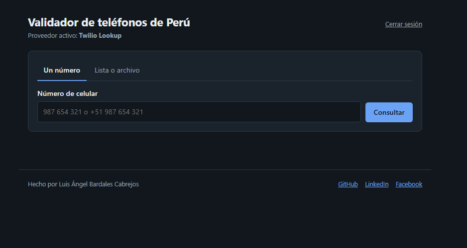

# Validador de teléfonos de Perú

App web en PHP para comprobar si un celular peruano existe y saber su operador.
Funciona con un número, o con una lista pegada o un archivo `.xlsx`, `.csv` o `.txt`.



## Qué hace
- Valida el formato (9 dígitos, empieza con 9, acepta +51).
- Descarta números inventados como 999 999 999 o 912 345 678. sin twilio 
- Con proveedor (Twilio Lookup) indica si el número es válido y su operador tambien funciona con otros proveedores.
- Guarda resultados en caché (SQLite) para no pagar dos veces por el mismo número se puede cambiara a alguna otra base de datos
- Exporta los resultados a CSV.

## Requisitos
PHP 8.1 o superior con las extensiones `curl`, `zip` y `pdo_sqlite`.

## Instalación
```bash
git clone https://github.com/langel3set/validador-telefonos.git
cd validador-telefonos
cp config.example.php config.php   # en Windows: copy config.example.php config.php
php -S localhost:8000
```
Abre http://localhost:8000 y entra con la clave que pusiste en `config.php`.

## Configuración
Edita `config.php`:
- `provider`: `offline` o `twilio` (valida y da operador).
- `twilio_sid` y `twilio_token`: tus credenciales de Twilio.

## Autor
[GitHub](https://github.com/langel3set/) · [LinkedIn](https://www.linkedin.com/in/luis-angel-bardales-cabrejos-aa160624a/) · [Facebook](https://www.facebook.com/luis.angel.355655)
